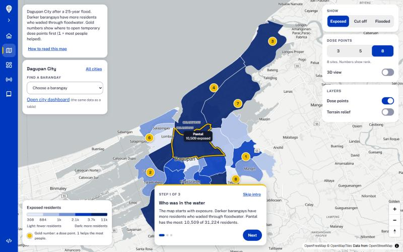

# LAMBAT

[](https://github.com/bih-science/lambat/actions/workflows/ci.yml)

**Leptospirosis Alert, Mapping and Barangay Allocation Tool.** *Lambat* is Filipino for *net*, and a net is only as good as where you cast it.

**In one sentence:** after a flood, LAMBAT shows a city health office which barangays waded through floodwater, who can no longer walk to a clinic, and where to open temporary stations for the free doxycycline that prevents leptospirosis.



*Darker barangays had more residents in the water. Gold numbers are where to set up dose points first.*

**See it:** run `uv run python scripts/build_web.py`, then `uv run python -m http.server 8000 -d web` and open http://localhost:8000. The map opens with a three-step guided tour.

| Folder | What is in it |
|---|---|
| `web/` | The site: home, map, city dashboard, radar page, method page |
| `src/lambat/` | The pipeline: data loading, exposure, walking access, dose-point siting, alert, radar flood mapping, validation |
| `scripts/` | One script per job: `run_pipeline.py`, `run_alert.py`, `train_unet.py`, `run_s1_flood.py`, `run_validation.py`, `build_web.py` |
| `results/` | What the scripts produce (tables, maps, summaries) |
| `docs/` | How each part works and how well it does: `flood.md`, `validation.md`, `sentinel1.md`, `development.md` |
| `tests/` | Automated tests, run on every push |

> The flood was gone by the time Rosa's fever came. For six days she had waded through it to sell fish. The capsule that could have protected her was free. But it was on the other side of the water.

Rosa is a composite; the numbers are not. By September 2026 the Philippines had 10,936 suspected leptospirosis cases, 3,005 more than a year earlier, while 3.73 million doxycycline capsules sat in government warehouses (Villanueva, 2026). The country did not run short of medicine. We think it ran short of a map. LAMBAT is that map, for a city health office in the days after a flood. Pilot: Dagupan City.

## The question is where, not how much

| Step | Question | Module |
|---|---|---|
| 1 | Where is the water? NOAH hazard map now; Sentinel-1 radar (threshold vs U-Net) when a pass arrives | `flood.py` |
| 2 | Who was in it, and how many capsules do they need? | `exposure.py` |
| 3 | Who can still walk to care in 30 minutes, with flooded roads slowed or closed? | `access.py` |
| 4 | Which 3, 5 or 8 sites would cover the most exposed residents? (maximal covering model) | `siting.py` |
| 5 | Should hospitals get ready? A rainfall alert two weeks ahead, on a separate clock | `alert.py` |

The **access gap** is the number of residents who can reach care on a dry day but not during the flood. That floods create such a gap is our **hypothesis**, not our premise: no study we found has measured it. If the gap turns out to be zero, the officer still gets exposure and capsule counts per barangay, which nobody hands them today. We report residents within reach of care, never lives saved.

## What the data says so far

We tested heat, air quality and waterborne disease first, on [Project CCHAIN](https://www.kaggle.com/datasets/thinkdatasci/project-cchain). They showed nothing (correlations within 0.02 of zero). Rain did: leptospirosis follows it 2 to 4 weeks later (pooled r = 0.29, Dagupan r = 0.45).

Is that enough to warn a hospital? Modestly. Trained on 2008 to 2016 and tested on 2017 to 2019, two weeks ahead (`scripts/run_alert.py`):

| Method | Correlation | Mean error (cases/week) | Outbreak weeks caught | False alerts |
|---|---|---|---|---|
| Seasonal average for that week | 0.50 | 1.24 | 21% | 6.8% |
| Last week's count | 0.48 | 1.53 | 26% | 5.1% |
| **Rain model** | **0.65** | **1.14** | **36%** | **1.7%** |

All three get the same number of alerts. That is an alert, not a forecast, and we call it one.

## What one run produces

`scripts/run_pipeline.py` runs steps 2 to 4 for Dagupan in about 5 seconds. For a 25-year flood:

- **71,868** of 208,322 residents live in flood-hazard areas: **143,737 capsules** for each week the water stays.
- **36** clinics and hospitals on OpenStreetMap. Within a 30-minute walk of one: 62,625 exposed residents on a dry day, 60,140 in the flood. The access gap is **2,485** people, smaller than we expected, and we say so.
- Most exposed residents who cannot reach care cannot reach it on dry days either. **3 temporary dose points** cover 6,030 of them, raising coverage to 92%; **8** reach 97%.
- Checked against 13 flood events named in the news, the ranking shows no detectable agreement (Spearman -0.10, 95% CI -0.48 to 0.30, 31 barangays). We tested 18 alternatives fixed in advance; none beats it after correcting for multiple comparisons. The reports mostly follow where people live (density correlation 0.64), so they are a weak ruler. We read this as "cannot confirm the ranking yet", not as proof it is wrong ([docs/validation.md](docs/validation.md)).

Barangay table, GeoJSON maps and a JSON summary land in `results/`.

## Seeing the water from orbit

Clouds hide floods from ordinary satellites; radar sees through them, and still water shows up dark. We trained a U-Net (resnet34 encoder, VV and VH bands in, water mask out) on the hand-labelled [Sen1Floods11](https://github.com/cloudtostreet/Sen1Floods11) chips. On 90 held-out chips from floods in other countries, it scores a pooled IoU of **0.64** against **0.21** for an Otsu threshold, and beats the threshold on 67 of the 82 chips that contain water (median per-chip IoU 0.33 vs 0.05). That is a global test, not a Dagupan one ([docs/flood.md](docs/flood.md)).

## Status

| Part | State |
|---|---|
| Data, alert, exposure, access, siting, end-to-end script | Working, tested, in CI |
| Flood mapping (threshold vs U-Net on Sen1Floods11) | Trained and scored (pooled IoU 0.64 vs 0.21) |
| Validation against news reports | Done, with confidence intervals; no detectable agreement |
| Sentinel-1 map of a real Dagupan flood (Typhoon Egay, 2023) | Code tested; running on the downloaded scenes |
| Dashboard (`web/`, MapLibre) | Map, priority table, dose points, alert chart; deploys to GitHub Pages once public |

## Run it

Needs [uv](https://docs.astral.sh/uv/). Data download steps are in [data/README.md](data/README.md).

```bash
uv sync
uv run pytest
uv run python scripts/run_alert.py
uv run python scripts/run_pipeline.py --scenario 25yr
uv sync --extra cv        # optional: PyTorch for the U-Net
```

## Limits

Case data is weekly, city-level and ends in 2022. The rain alert cannot see tidal flooding. Access is modelled from maps, not checked on the ground. Each dose point assumes a prescriber. The tool counts places, not patients: pregnant and lactating women are flagged for referral, and the undiagnosed do not appear.

For Rosa, all of this comes down to one line on a printed sheet: her barangay, near the top of the list, before the fever comes.

<sub>Built for the Philippine Junior Data Science Challenge 2026. Data: Project CCHAIN (CC BY 4.0), UP NOAH, OpenStreetMap, Sentinel-1, Sen1Floods11.</sub>
