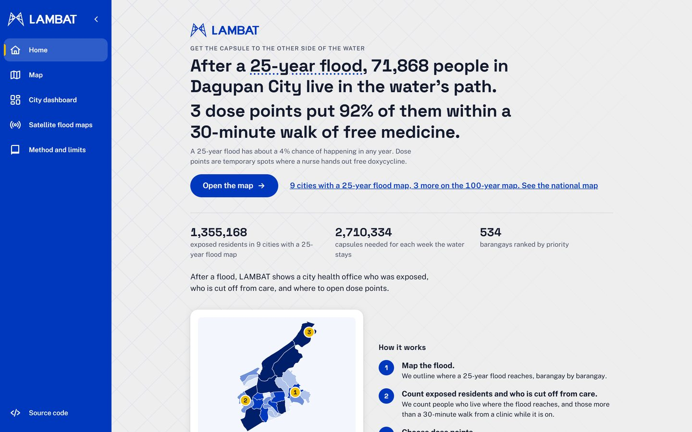
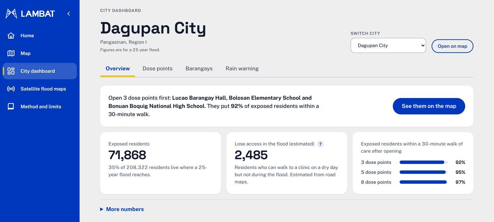
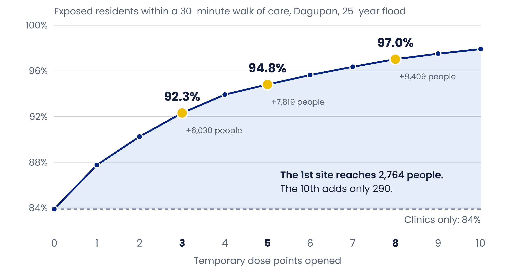
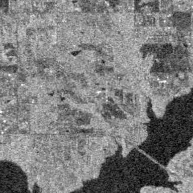
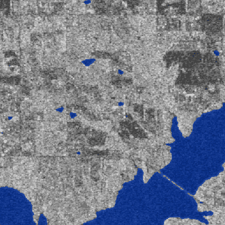
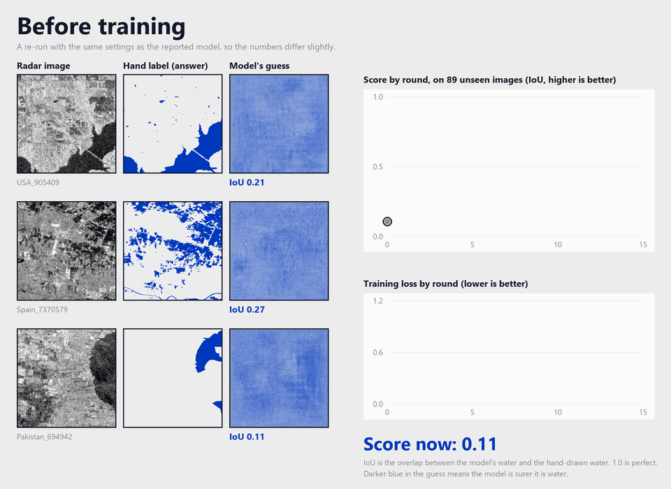
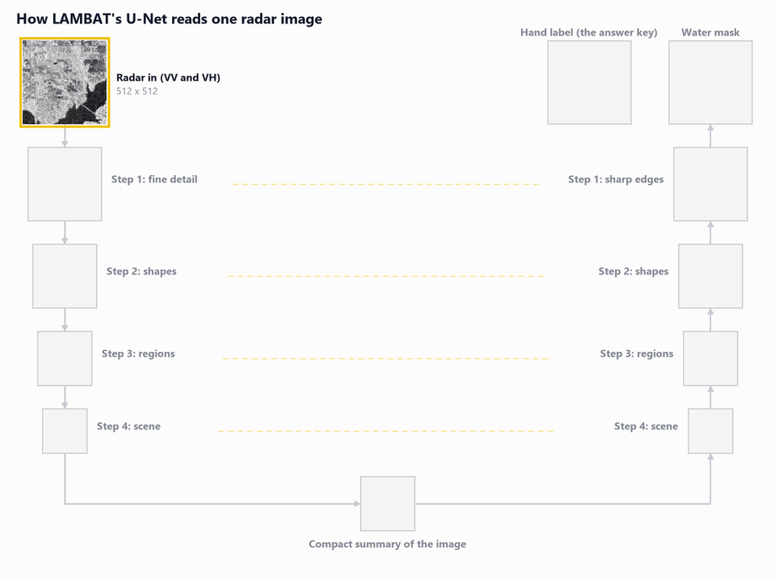
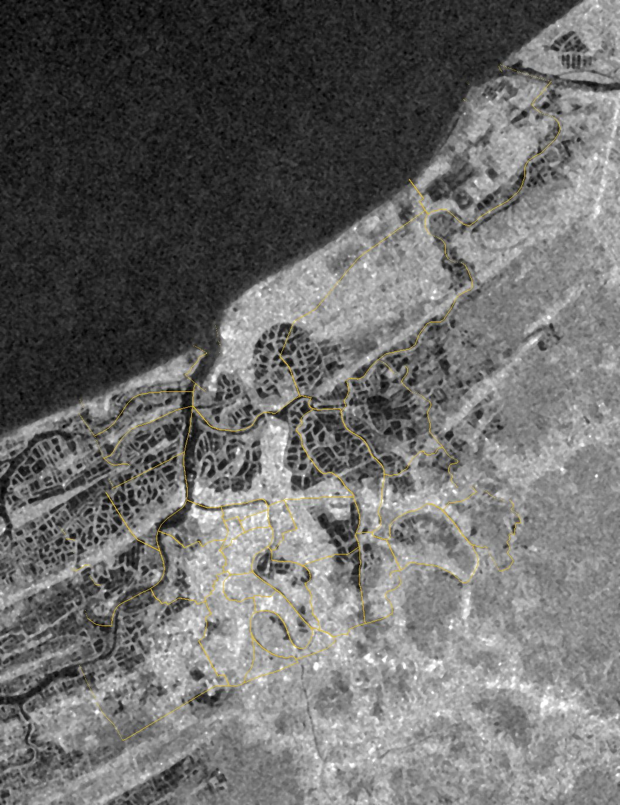
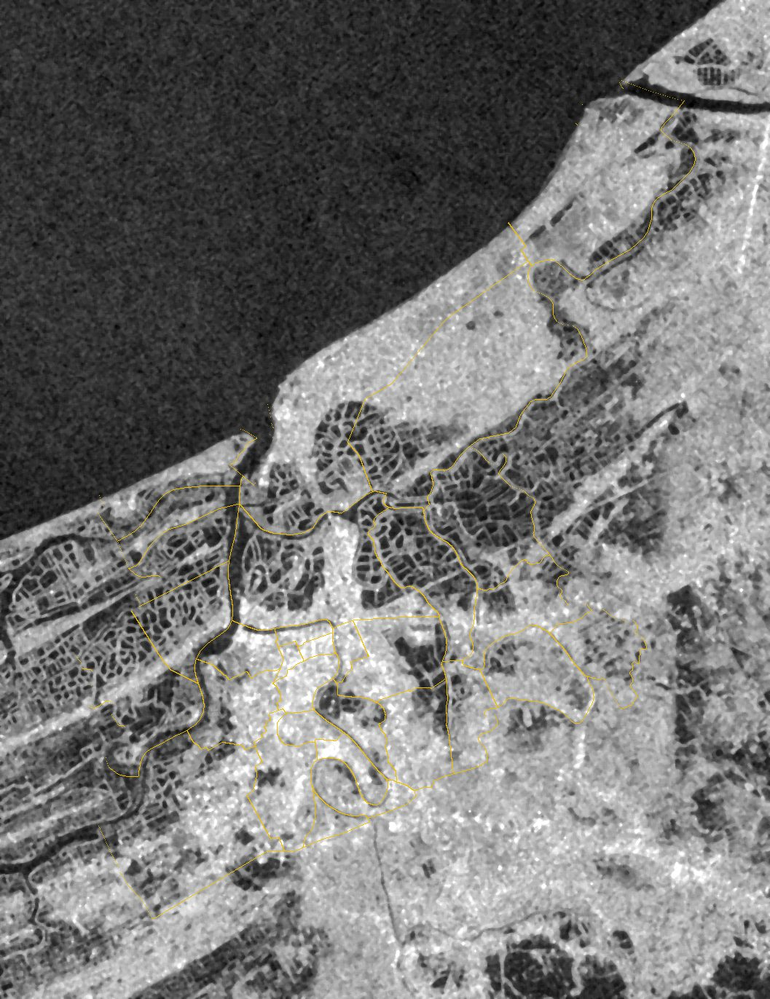
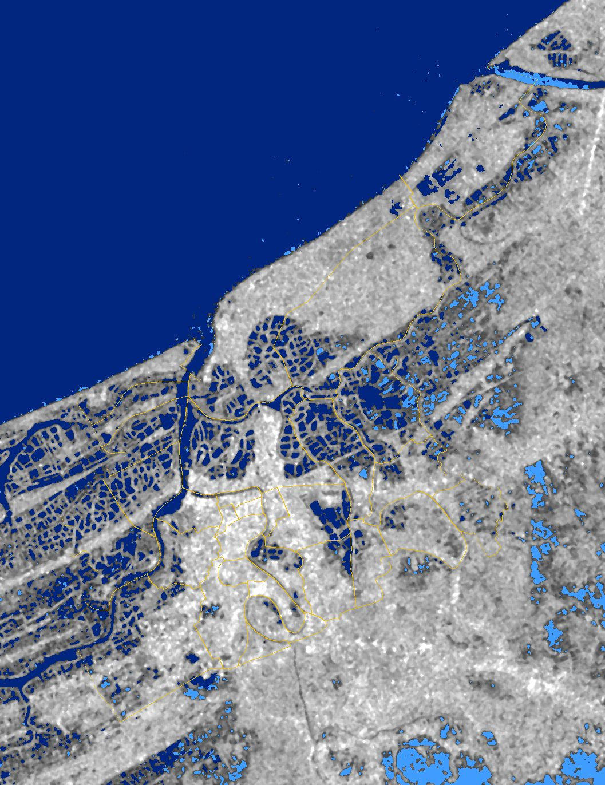

# LAMBAT

[](https://github.com/lambat-ph/lambat/actions/workflows/ci.yml)

**Leptospirosis Alert, Mapping and Barangay Allocation Tool.** *Lambat* is Filipino for *net*, and a net is only as good as where you cast it.

**In one sentence:** after a flood, LAMBAT shows a city health office which barangays waded through floodwater, who can no longer walk to a clinic, and where to open temporary stations for the free doxycycline that prevents leptospirosis.


*Darker barangays had more residents in the water. Gold numbers are where to set up dose points first.*

**See it live: [lambat-ph.github.io/lambat](https://lambat-ph.github.io/lambat/).** The map opens with a three-step guided tour. To run the site locally: `uv run python scripts/build_web.py`, then `uv run python -m http.server 8000 -d web` and open http://localhost:8000.

| Home | City dashboard |
|---|---|
|  |  |

| Folder | What is in it |
|---|---|
| `web/` | The site: home, map, city dashboard, radar page, method page |
| `src/lambat/` | The pipeline: data loading, exposure, walking access, dose-point siting, alert, radar flood mapping, validation |
| `scripts/` | One script per job: `run_pipeline.py`, `run_alert.py`, `train_unet.py`, `run_s1_flood.py`, `run_validation.py`, `build_web.py` |
| `results/` | What the scripts produce (tables, maps, summaries) |
| `docs/` | How each part works and how well it does: `flood.md`, `validation.md`, `sentinel1.md`, `development.md` |
| `tests/` | Automated tests, run on every push |

> The flood was gone by the time Rosa's fever came. For six days she had waded through it to sell fish. The capsule that could have protected her was free. But it was on the other side of the water.

Rosa is a composite; the numbers are not. By September 2026 the Philippines had 10,936 suspected leptospirosis cases, 3,005 more than a year earlier, while 3.73 million doxycycline capsules sat in government warehouses (Villanueva, 2026). The country did not run short of medicine. We think it ran short of a map. LAMBAT is that map, for a city health office in the days after a flood. Pilot: Dagupan City.

## The question is where, not how much

| Step | Question | Module |
|---|---|---|
| 1 | Where is the water? NOAH hazard map now; Sentinel-1 radar (threshold vs U-Net) when a pass arrives | `flood.py` |
| 2 | Who was in it, and how many capsules do they need? | `exposure.py` |
| 3 | Who can still walk to care in 30 minutes, with flooded roads slowed or closed? | `access.py` |
| 4 | Which 3, 5 or 8 sites would cover the most exposed residents? (maximal covering model) | `siting.py` |
| 5 | Should hospitals get ready? A rainfall alert two weeks ahead, on a separate clock | `alert.py` |

The **access gap** is the number of residents who can reach care on a dry day but not during the flood. That floods create such a gap is our **hypothesis**, not our premise: no study we found has measured it. If the gap turns out to be zero, the officer still gets exposure and capsule counts per barangay, which nobody hands them today. We report residents within reach of care, never lives saved.

## What the data says so far

We tested heat, air quality and waterborne disease first, on [Project CCHAIN](https://www.kaggle.com/datasets/thinkdatasci/project-cchain). They showed nothing (correlations within 0.02 of zero). Rain did: leptospirosis follows it 2 to 4 weeks later (pooled r = 0.29, Dagupan r = 0.45).

Is that enough to warn a hospital? Modestly. Trained on 2008 to 2016 and tested on 2017 to 2019, two weeks ahead (`scripts/run_alert.py`):

| Method | Correlation | Mean error (cases/week) | Outbreak weeks caught | False alerts |
|---|---|---|---|---|
| Seasonal average for that week | 0.50 | 1.24 | 21% | 6.8% |
| Last week's count | 0.48 | 1.53 | 26% | 5.1% |
| **Rain model** | **0.65** | **1.14** | **36%** | **1.7%** |

All three get the same number of alerts. That is an alert, not a forecast, and we call it one.

## What one run produces

`scripts/run_pipeline.py` runs steps 2 to 4 for Dagupan in about 5 seconds. For a 25-year flood:

- **71,868** of 208,322 residents live in flood-hazard areas: **143,737 capsules** for each week the water stays.
- **36** clinics and hospitals on OpenStreetMap. Within a 30-minute walk of one: 62,625 exposed residents on a dry day, 60,140 in the flood. The access gap is **2,485** people, smaller than we expected, and we say so.
- Most exposed residents who cannot reach care cannot reach it on dry days either. **3 temporary dose points** (Lucao Barangay Hall, Bolosan Elementary School, Bonuan Boquig National High School, in that order) cover 6,030 of them, raising coverage to 92%; 5 reach 95% and **8** reach 97%. The 3, 5 and 8 are example staffing budgets, not numbers the model picked; the full curve for 1 to 10 dose points shows each extra site reaching fewer new people (the 1st reaches 2,764, the 10th only 290):

  
- Checked against 13 flood events named in the news, the ranking shows no detectable agreement (Spearman -0.10, 95% CI -0.48 to 0.30, 31 barangays). We tested 18 alternatives fixed in advance; none beats it after correcting for multiple comparisons. The reports mostly follow where people live (density correlation 0.64), so they are a weak ruler. We read this as "cannot confirm the ranking yet", not as proof it is wrong ([docs/validation.md](docs/validation.md)).

Barangay table, GeoJSON maps and a JSON summary land in `results/`.

## Cities

The pipeline has been run for all 12 Project CCHAIN cities. Dagupan is the pilot and the only one checked against news reports.

| City | Flood map | Population | Exposed | Coverage after 3 / 5 / 8 dose points |
|---|---|---|---|---|
| Dagupan | 25-year | 208,322 | 71,868 | 92% / 95% / 97% |
| Palayan | 25-year | 55,563 | 17,576 | 48% / 55% / 59% |
| Legazpi | 25-year | 198,162 | 34,154 | 98% / 99% / 99% |
| Zamboanga | 25-year | 860,500 | 191,991 | 61% / 65% / 70% |
| Cagayan de Oro | 25-year | 752,065 | 285,533 | 61% / 63% / 65% |
| Davao | 25-year | 1,706,762 | 346,421 | 67% / 67% / 67% |
| Mandaluyong | 25-year | 411,208 | 135,447 | 90% / 90% / 90% |
| Navotas | 25-year | 287,226 | 155,149 | 92% / 92% / 92% |
| Muntinlupa | 25-year | 478,644 | 117,029 | 84% / 84% / 85% |
| Iloilo | 100-year | 424,837 | 176,430 | 74% / 76% / 80% |
| Mandaue | 100-year | 356,165 | 142,030 | 87% / 88% / 89% |
| Tacloban | 100-year | 200,382 | 54,888 | 79% / 79% / 79% |

The national total counts only the 25-year cities: 1,355,168 exposed residents across 9 cities (`web/data/national.json`). Iloilo, Mandaue and Tacloban have no 25-year map in Project CCHAIN, so they are shown on the larger 100-year map and are not added to the total.

## Seeing the water from orbit

Clouds hide floods from ordinary satellites; radar sees through them, and still water shows up dark. We trained a U-Net (resnet34 encoder, VV and VH bands in, water mask out) on the hand-labelled [Sen1Floods11](https://github.com/cloudtostreet/Sen1Floods11) chips. On 90 held-out chips from floods in other countries, it scores a pooled IoU of **0.64** against **0.21** for an Otsu threshold, and beats the threshold on 67 of the 82 chips that contain water (median per-chip IoU 0.33 vs 0.05). That is a global test, not a Dagupan one ([docs/flood.md](docs/flood.md)).

| Radar (what the satellite sees) | Our U-Net's water mask | The real flood (hand-drawn) |
|---|---|---|
|  |  |  |

*One of the clearer test chips (overlap 0.94). The typical chip scores 0.33.*

**How it learned.** Before training the guesses are close to random; after each of 15 rounds they get closer to the hand-drawn water, while the score on unseen chips climbs (a re-run with the same settings, so numbers differ slightly from the reported run):



**How it reads one image.** The encoder shrinks the radar picture into more abstract features; the decoder rebuilds a sharp water map, with skip connections (gold) passing detail across:



### A real Dagupan flood: Typhoon Egay, July 2023

We compared a Sentinel-1 pass two days after landfall (28 July 2023) with a dry pass from the same orbit (11 April 2023):

| Before: 11 April 2023 | After: 28 July 2023 | New water found |
|---|---|---|
|  |  |  |

Only 0.46 km2 of new open water showed inside the city (about 1.2% of its land). Per barangay, it agrees with NOAH's 100-year hazard map (Spearman 0.54, 95% CI 0.18 to 0.80) but not clearly with the 25-year map the pipeline uses (0.23, CI -0.17 to 0.56), and the news reports name 26 of 31 barangays, so they cannot separate a good map from a bad one. With no hand-drawn map of where Egay's water went, this is a consistency check, not a score. Radar also misses flooded streets between buildings, so downtown is probably undercounted ([docs/sentinel1.md](docs/sentinel1.md)).

The trained U-Net (94 MB) is on the [unet-v1 release](https://github.com/lambat-ph/lambat/releases/tag/unet-v1).

## Status

| Part | State |
|---|---|
| Data, alert, exposure, access, siting, end-to-end script | Working, tested, in CI |
| Flood mapping (threshold vs U-Net on Sen1Floods11) | Trained and scored (pooled IoU 0.64 vs 0.21) |
| Validation against news reports | Done, with confidence intervals; no detectable agreement |
| Sentinel-1 map of a real Dagupan flood (Typhoon Egay, 2023) | Run: 0.46 km2 of new water inside the city two days after landfall; matches NOAH 100-year map (rho 0.54), not the 25-year map or news reports ([docs/sentinel1.md](docs/sentinel1.md)) |
| Dashboard (`web/`, MapLibre) | Multi-city map (12 cities, with a national summary), priority table, dose points, alert chart, satellite page; live on [GitHub Pages](https://lambat-ph.github.io/lambat/) |

## Run it

Needs [uv](https://docs.astral.sh/uv/). Data download steps are in [data/README.md](data/README.md).

```bash
uv sync
uv run pytest
uv run python scripts/run_alert.py
uv run python scripts/run_pipeline.py --scenario 25yr
uv sync --extra cv        # optional: PyTorch for the U-Net
```

The trained U-Net (94 MB) is kept out of git. Download `unet_sen1floods11.pt` from the [unet-v1 release](https://github.com/lambat-ph/lambat/releases/tag/unet-v1) into `checkpoints/`, or retrain it with `scripts/train_unet.py`.

## Limits

Case data is weekly, city-level and ends in 2022. The rain alert cannot see tidal flooding. Access is modelled from maps, not checked on the ground. Each dose point assumes a prescriber. The tool counts places, not patients: pregnant and lactating women are flagged for referral, and the undiagnosed do not appear.

For Rosa, all of this comes down to one line on a printed sheet: her barangay, near the top of the list, before the fever comes.

<sub>Built for the Philippine Junior Data Science Challenge 2026. Data: Project CCHAIN (CC BY 4.0), UP NOAH, OpenStreetMap, Sentinel-1, Sen1Floods11.</sub>
